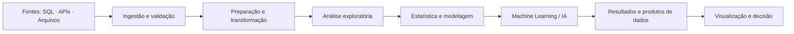
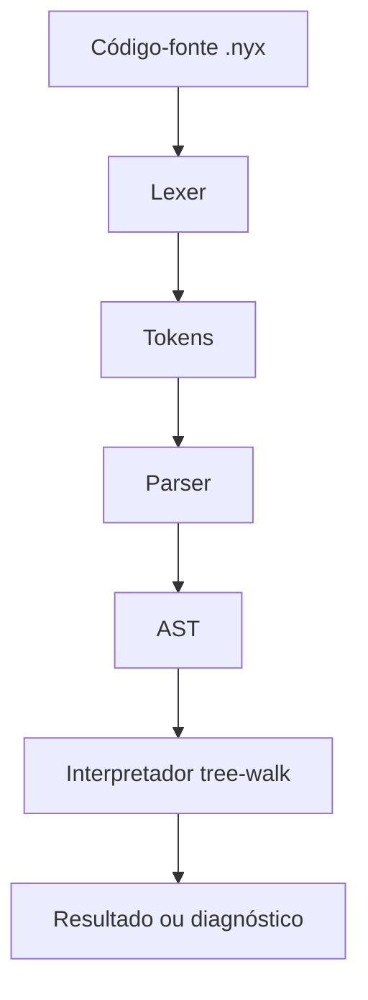
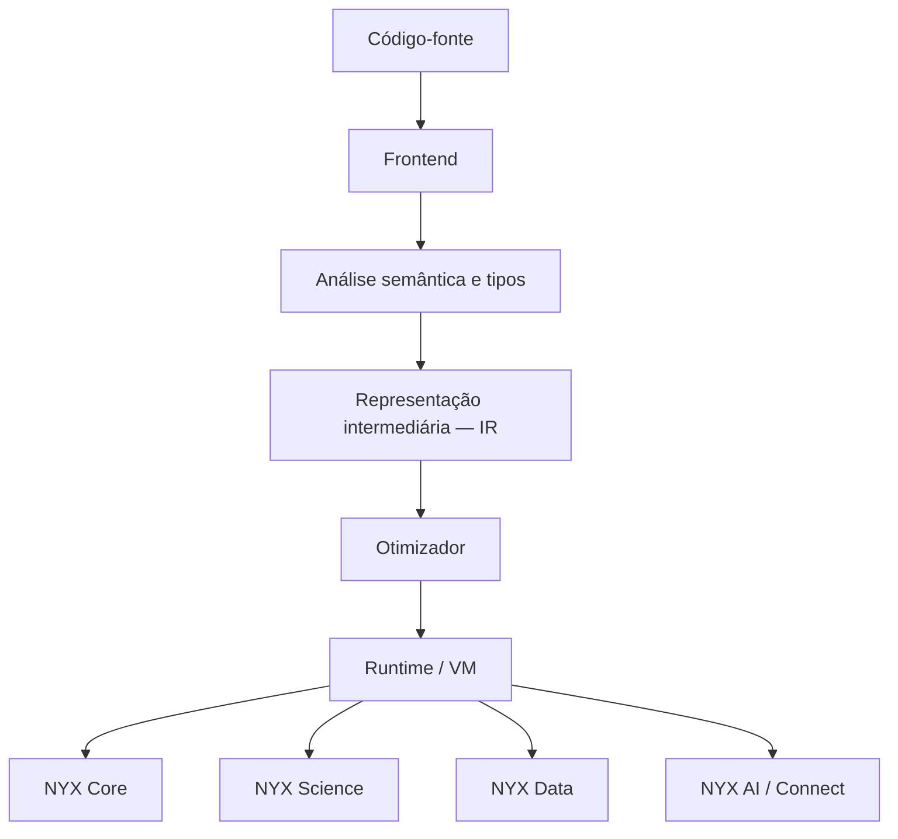

<div align="center">


# NYX CODE

### NR TECH | LINGUAGEM DE PROGRAMAÇÃO PARA CIÊNCIA, DADOS E COMPUTAÇÃO

Uma linguagem independente em construção, com sintaxe, semântica e arquitetura próprias.

**Think Scientifically. Compute Intelligently.**


[Documentação](docs/ESPECIFICACAO_INICIAL.md) · [Arquitetura](docs/ARQUITETURA.md) · [Roadmap](docs/ROADMAP.md) · [Releases](https://github.com/nrdataanalysis-1908/NYX-CODE/releases)

</div>

<p align="center">
  
</p>

---

## 01. Visão do projeto

A NYX é um projeto autoral da NR TECH que busca desenvolver uma linguagem de programação independente, orientada à computação científica, ciência de dados, engenharia de dados, automação e interoperabilidade.

A proposta é construir uma base computacional coerente: linguagem própria, regras semânticas explícitas, estruturas de dados, execução verificável e integração com diferentes ecossistemas.

A NYX não pretende ser apenas uma camada sintática sobre Python. Python hospeda o protótipo atual, mas não define a identidade, a gramática ou a semântica da linguagem.

> [!IMPORTANT]
> Estado real: alfa, especificação 0.7 na branch de desenvolvimento. O núcleo já possui lexer, parser, AST, interpretador, variáveis, expressões, controle de fluxo, funções, listas, iteração e agregações numéricas. Compilador nativo, sistema de tipos estático, matrizes, tabelas, bibliotecas científicas, paralelismo e módulos de IA ainda não estão implementados.

## 02. Identidade: Numerical · Yield · eXchange

| Símbolo | Significado | Princípio |
|:---:|---|---|
| **N** | **Numerical** | Fundamento matemático, numérico e computacional |
| **Y** | **Yield** | Produção de resultados, conhecimento e valor verificável |
| **X** | **eXchange** | Interoperabilidade entre linguagens, dados, serviços e infraestruturas |

### Diretrizes fundamentais

- **Independência semântica:** a NYX define suas próprias regras e evolução.
- **Rigor científico:** precisão, comportamento numérico e limitações documentados.
- **Dados como domínio central:** estruturas e transformações de dados como eixo de evolução.
- **Interoperabilidade:** integração por interfaces, contratos e conectores explícitos.
- **IA desacoplada:** modelos de IA serão integráveis, mas não necessários para interpretar ou executar código NYX.
- **Desempenho mensurável:** otimizações sustentadas por benchmarks reproduzíveis.
- **Evolução verificável:** nenhuma capacidade é considerada pronta sem implementação, testes e documentação.

## 03. Núcleo implementado

Recursos existentes na linha de desenvolvimento correspondente à especificação 0.7:

| Camada | Recursos | Situação |
|---|---|---|
| Frontend | Lexer, tokens, parser e AST próprios | Implementado |
| Tipos fundamentais | Integer, Float, String, Boolean e Null | Implementado |
| Estado | Declaração `let`, atribuição e escopos | Implementado |
| Expressões | Aritmética, comparação e lógica | Implementado |
| Controle | `if`, `else`, `while` e `for` | Implementado |
| Funções | `fn`, parâmetros, chamadas, retorno e recursão | Implementado |
| Coleções | Listas heterogêneas, aninhadas e mutáveis | Implementado |
| Indexação | Leitura, indexação aninhada e atribuição por índice | Implementado |
| Built-ins | `len()`, `append()`, `sum()`, `mean()`, `min()` e `max()` | Implementado |
| Execução | Interpretador tree-walk e CLI | Implementado |
| Diagnóstico | Erros com linha e coluna | Implementado |

### Exemplo de código NYX

```nyx
fn calcular_media(valores) {
    let total = 0
    let indice = 0

    while (indice < len(valores)) {
        total = total + valores[indice]
        indice = indice + 1
    }

    return total / len(valores)
}

let leituras = [21.5, 22.0, 23.4, 24.1]
let resultado = calcular_media(leituras)

print(resultado)
```

O exemplo utiliza recursos implementados no núcleo atual, incluindo iteração e agregações nativas.

### Iteração e agregações

```nyx
let measurements = [18.2, 19.1, 20.4]

for (let measurement in measurements) {
    print(measurement)
}

print(sum(measurements))
print(mean(measurements))
print(min(measurements))
print(max(measurements))
```

O laço `for` percorre listas em ordem e mantém a variável de iteração em escopo próprio. As agregações aceitam listas exclusivamente numéricas.

### Exemplos disponíveis

| Arquivo | Demonstração |
|---|---|
| [00_primeiro_programa.nyx](examples/00_primeiro_programa.nyx) | Sintaxe e expressões |
| [01_controle_de_fluxo.nyx](examples/01_controle_de_fluxo.nyx) | Condicionais, laços e atribuição |
| [02_colecoes.nyx](examples/02_colecoes.nyx) | Listas, indexação e mutabilidade |

## 04. Ciência de dados e domínios computacionais

A NYX nasce com uma orientação multidisciplinar. O objetivo de longo prazo é oferecer uma linguagem capaz de transitar entre fundamentos matemáticos, processamento de dados, análise, modelagem e integração de sistemas.

| Domínio planejado | Escopo | Capacidades pretendidas |
|---|---|---|
| **NYX Core** | Linguagem e execução | Tipos, módulos, runtime, memória e semântica |
| **NYX Science** | Computação científica | Álgebra linear, estatística, probabilidade, matrizes e tensores |
| **NYX Data** | Engenharia e ciência de dados | Dados tabulares, ingestão, filtros, joins, agregações e pipelines |
| **NYX AI** | Inteligência artificial | Machine learning, inferência e integração com modelos |
| **NYX Connect** | Interoperabilidade | SQL, APIs, bancos, arquivos e bibliotecas externas |
| **NYX Runtime** | Desempenho | IR, otimização, concorrência e execução paralela |

> Os domínios acima representam a arquitetura pretendida. Não são módulos disponíveis na versão alfa atual.

### Ciclo de ciência de dados — visão conceitual



### Quadro comparativo de posicionamento

A tabela compara paradigmas e posicionamento, não desempenho. Python, R, SQL e plataformas distribuídas são ecossistemas maduros; NYX ainda está em estágio alfa.

| Critério | Linguagens generalistas | Ecossistemas científicos e de dados | Direção da NYX |
|---|---|---|---|
| Finalidade | Uso amplo e multiparadigma | Análise e processamento especializados | Ciência, dados e computação em uma linguagem independente |
| Semântica | Definida pela linguagem | Linguagem, bibliotecas e plataformas | Semântica própria e especificada |
| Computação científica | Bibliotecas e extensões | Ferramentas científicas consolidadas | Recursos científicos planejados |
| Engenharia de dados | Bibliotecas e frameworks | Pipelines e motores especializados | Domínio de dados planejado |
| IA e ML | Bibliotecas e serviços | Ecossistemas especializados | Camada de IA desacoplada planejada |
| Interoperabilidade | Varia por ecossistema | Conectores e APIs | Princípio arquitetural explícito |
| Runtime | Varia por linguagem | Varia por plataforma | Runtime próprio no horizonte |
| Maturidade | Ecossistemas estabelecidos | Ecossistemas estabelecidos | Alfa — núcleo inicial |

## 05. Arquitetura

### Pipeline de execução atual



### Evolução arquitetural pretendida



O primeiro diagrama representa a implementação atual. O segundo expressa uma direção de arquitetura futura. A linguagem deve permanecer independente da tecnologia hospedeira. Python é utilizado no protótipo; uma infraestrutura em Rust é uma possibilidade futura, não uma dependência atual.

## 06. Instalação e execução

### Requisitos

- Python 3.10 ou superior.
- Git.

### Obter o código-fonte

```powershell
git clone --branch nrdataanalysis-1908-patch-1 https://github.com/nrdataanalysis-1908/NYX-CODE.git
cd NYX-CODE

python -m venv .venv
.\.venv\Scripts\Activate.ps1
python -m pip install -e ".[dev]"
```

### Executar um programa

```powershell
nyx run examples/03_iteracao_e_agregacoes.nyx
```

Alternativa:

```powershell
python -m nyx run examples/02_colecoes.nyx
```

### Executar os testes

```powershell
python -m pytest -q
```

### Distribuição PyPI

O pacote registrado é [nrtech-nyx](https://pypi.org/project/nrtech-nyx/). A versão publicada 0.1.0a1 é uma prévia anterior e não corresponde a todos os recursos da especificação 0.6.

```powershell
python -m pip install nrtech-nyx
```

Para experimentar as funcionalidades descritas na especificação 0.6, utilize a instalação a partir do código-fonte da branch de desenvolvimento.

## 07. Roadmap

| Etapa | Frente | Objetivo |
|:---:|---|---|
| 01 | Fundação | Gramática, semântica e testes de conformidade |
| 02 | Sistema de tipos | Tipagem, análise semântica e inferência |
| 03 | NYX Science | Vetores, matrizes, estatística e operações numéricas |
| 04 | NYX Data | Estruturas tabulares, arquivos e pipelines |
| 05 | Runtime | IR, otimização e benchmarks |
| 06 | Execução avançada | Concorrência, paralelismo e gestão de memória |
| 07 | NYX AI | Interfaces de ML, inferência e integrações |
| 08 | Ecossistema | Módulos, pacotes, documentação e ferramentas |

Cada etapa deverá ser acompanhada por implementação funcional, testes automatizados, documentação e critérios de aceitação.

## 08. Qualidade e validação

A linha de desenvolvimento possui testes automatizados e integração contínua para múltiplas versões do Python. A validação deve contemplar casos positivos, entradas inválidas, limites, escopos, tipos, mutabilidade e diagnósticos.

Alegações de desempenho dependerão de benchmarks reproduzíveis, ambiente documentado e comparação equivalente.

## 09. Estrutura do projeto

```text
NYX-CODE/
├── src/nyx/              # Lexer, parser, AST, interpretador e CLI
├── tests/                # Testes automatizados
├── examples/             # Programas de demonstração
├── docs/                 # Especificação, arquitetura e roadmap
├── assets/               # Identidade visual NYX
├── .github/workflows/    # CI e publicação
├── pyproject.toml
└── README.md
```

## 10. Contribuição

A NYX está em estágio alfa. Contribuições devem preservar a coerência da linguagem:

1. Consulte a especificação antes de propor mudanças sintáticas ou semânticas.
2. Descreva motivação, comportamento esperado e impacto.
3. Inclua testes para funcionalidades e regressões.
4. Atualize documentação e exemplos.
5. Diferencie claramente capacidades implementadas de propostas futuras.

## 11. Licença

Distribuído sob a licença Apache License 2.0. Consulte o arquivo [LICENSE](LICENSE).

---

<div align="center">


### NYX · NR TECH

**Think Scientifically. Compute Intelligently.**

Uma linguagem em construção. Uma arquitetura guiada por rigor, interoperabilidade e evolução verificável.

</div>
