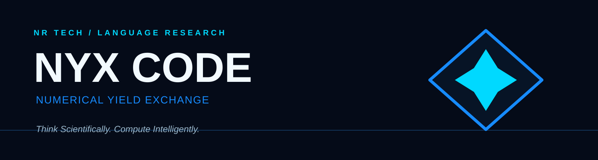
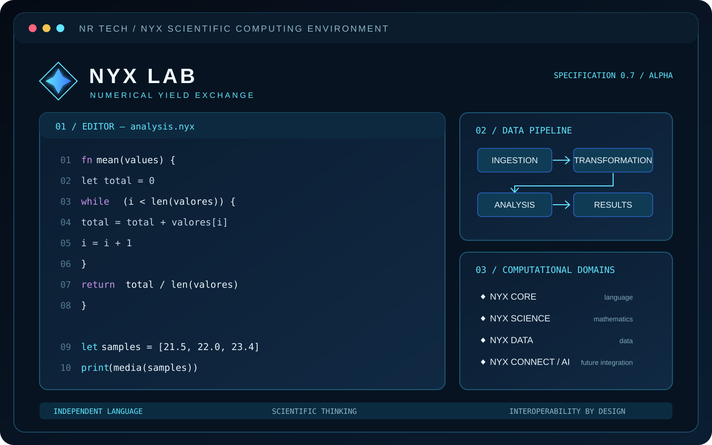
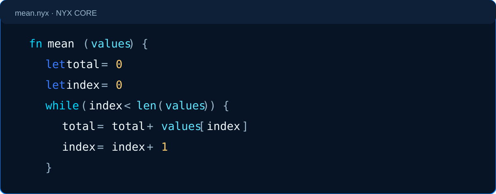
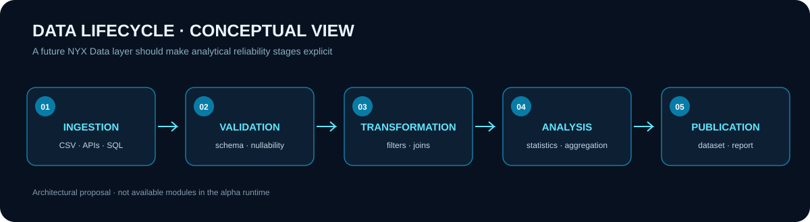
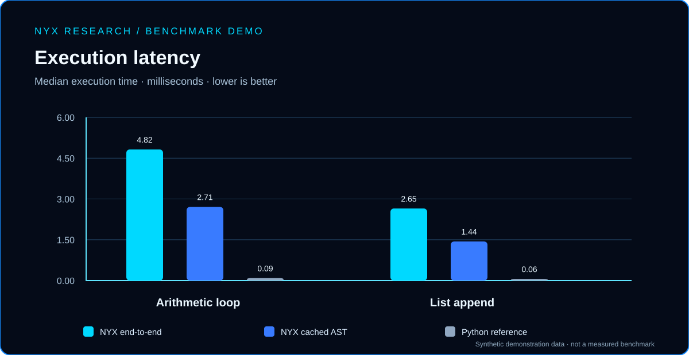
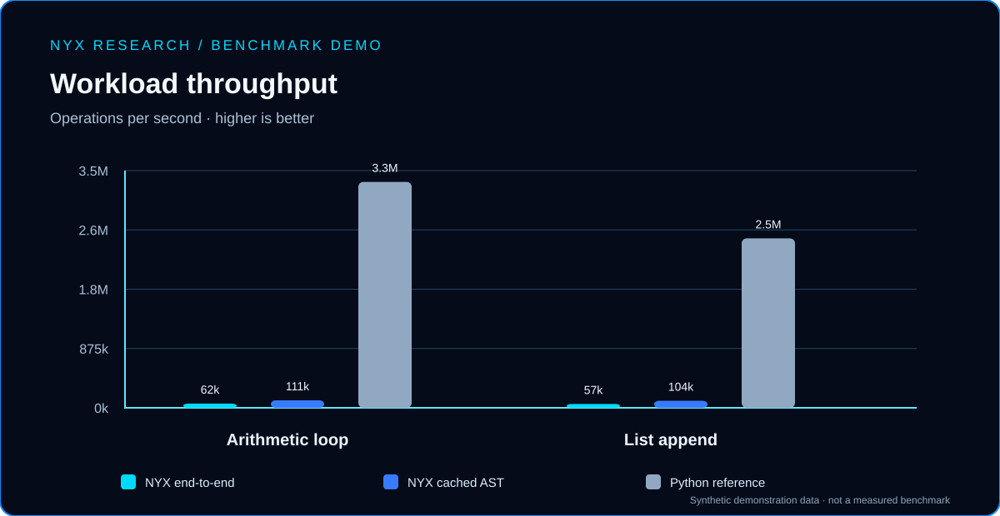
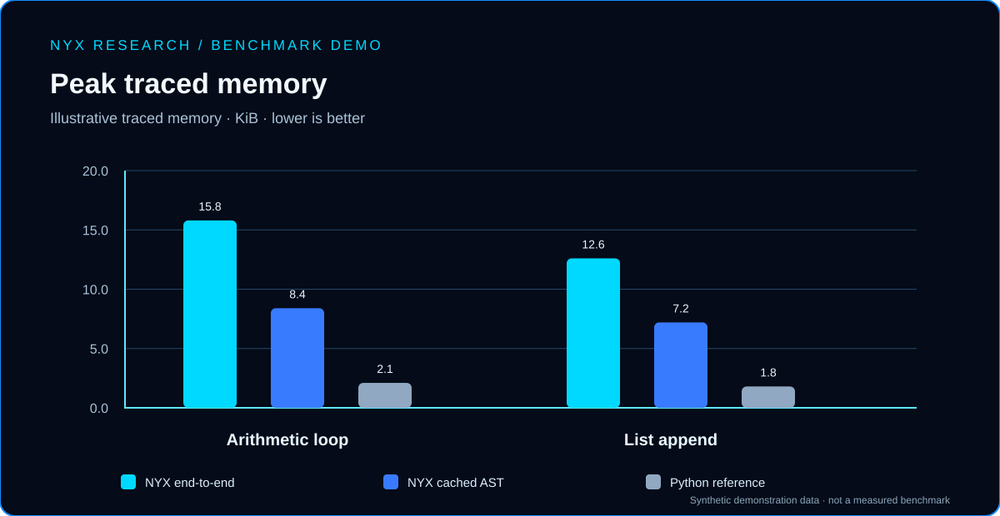
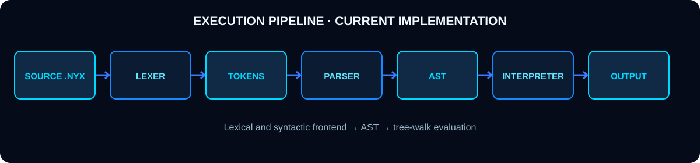
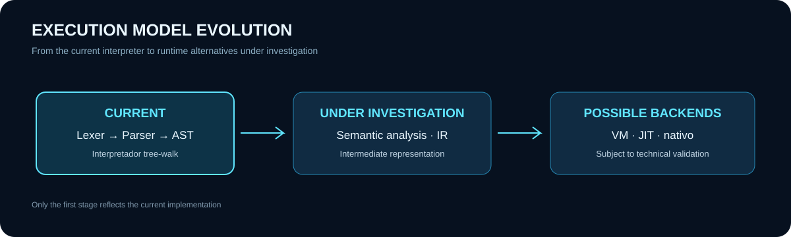
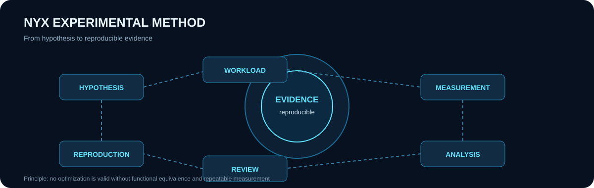

# NYX — Numerical Yield eXchange

### An independent programming language for data science, scientific computing, and analytical engineering

**Think Scientifically. Compute Intelligently.**

[Language Specification](docs/LANGUAGE_SPECIFICATION.md) · [Language Design Draft](docs/LANGUAGE_DESIGN_DRAFT.md) · [Architecture](docs/ARCHITECTURE.md) · [Scientific Examples](docs/SCIENTIFIC_EXAMPLES.md) · [Roadmap](docs/ROADMAP.md)

  

---

## 01. Project vision

NYX is an independent programming-language project by NR TECH. It is designed to bring programming-language engineering, data science, numerical computing, and data engineering together under a coherent semantic model.

The goal is not to create another syntax layer over Python. NYX is intended to define its own grammar, abstract syntax tree, execution semantics, data abstractions, and runtime contracts. Python currently hosts the prototype; it does not define the language itself.

The long-term direction includes:

- an independently specified language and execution model;
- reliable numerical and scientific-computing primitives;
- data structures and transformations for analytical workloads;
- reproducible execution and measurable performance;
- interoperability with databases, APIs, files, languages, and infrastructure;
- optional, decoupled machine-learning and AI integrations.

> [!IMPORTANT]
> Current status: alpha, Language Specification 0.7 on the development branch. The implemented core includes a lexer, parser, AST, tree-walk interpreter, variables, expressions, control flow, functions, mutable lists, iteration, and numeric list aggregations. A native compiler, static type system, matrices, tabular engine, scientific libraries, parallel execution, and native AI modules are not implemented.

## 02. The language in code

The examples below use constructs available in the current development implementation.

### Descriptive statistics — arithmetic mean

\`\`\`nyx
fn mean(values) {
    let total = 0
    let index = 0

    while (index < len(values)) {
        total = total + values[index]
        index = index + 1
    }

    return total / len(values)
}

let sensor_readings = [21.5, 22.0, 23.4, 24.1, 22.8]
let average = mean(sensor_readings)

print(average)
\`\`\`

This is a user-defined function built from the language's current core. It is not a native statistics library.

### Recursion and function composition

\`\`\`nyx
fn factorial(n) {
    if (n <= 1) {
        return 1
    }

    return n * factorial(n - 1)
}

fn normalize(value, maximum) {
    return value / maximum
}

let observation = factorial(5)
let normalized = normalize(observation, 200)

print(observation)
print(normalized)
\`\`\`

### Collections and mutability

\`\`\`nyx
let measurements = [18.2, 19.4, 20.1]
let matrix = [[1, 2], [3, 4]]

measurements[1] = 19.8
append(measurements, 21.3)

print(len(measurements))
print(matrix[1][0])
print(measurements[1])
\`\`\`

Lists are mutable and shared by reference. The current implementation supports nested lists and indexed assignment; it does not yet provide a scientific matrix type.

### Iteration and numeric aggregations

\`\`\`nyx
let measurements = [18.2, 19.1, 20.4]

for (let measurement in measurements) {
    print(measurement)
}

print(sum(measurements))
print(mean(measurements))
print(min(measurements))
print(max(measurements))
\`\`\`

The for loop iterates over a snapshot of a list in its original order. The variable declared by let is scoped to the loop. The built-in aggregation functions accept lists containing only Integer and Float values.

## 03. Implemented language core

The following capabilities are implemented on the development branch for specification 0.7.

| Layer | Capabilities | Status |
|---|---|---|
| Frontend | Lexer, tokens, recursive-descent parser, and AST | Implemented |
| Primitive values | Integer, Float, String, Boolean, and Null | Implemented |
| State | let declarations, assignment, and lexical scopes | Implemented |
| Expressions | Arithmetic, comparison, logical operators, and precedence | Implemented |
| Control flow | if, else, while, and for-in | Implemented |
| Functions | Parameters, calls, return values, recursion, and closures | Implemented |
| Collections | Empty, heterogeneous, nested, mutable lists | Implemented |
| Indexing | Zero-based indexing, nested reads, and indexed assignment | Implemented |
| Built-ins | len(), append(), sum(), mean(), min(), and max() | Implemented |
| Execution | Tree-walk interpreter and command-line interface | Implemented |
| Diagnostics | Lexical, syntactic, and runtime errors with line and column | Implemented |

## 04. From language core to scientific ecosystem

NYX is organized around specialized domains. This separation is intended to preserve a coherent language core while allowing libraries and engines to evolve under explicit contracts.

| Domain | Intended scope | Planned engineering direction |
|---|---|---|
| NYX Core | Syntax, semantics, types, modules, and execution | Lexer, parser, AST, runtime, and type system |
| NYX Math | Numerical arithmetic and mathematical functions | Precision, numeric promotion, and operations |
| NYX Science | Statistics, probability, and linear algebra | Vectors, matrices, distributions, and tensors |
| NYX Data | Ingestion, preparation, quality, and analysis | Schemas, tabular structures, and data transformations |
| NYX AI | Machine learning and model integration | Training and inference interfaces |
| NYX Connect | Interoperability | SQL, APIs, databases, files, and external libraries |
| NYX Runtime | Execution and performance | Intermediate representation, optimization, and parallelism |

These domains describe the intended architecture. They are not modules available in the current alpha runtime.

### Tabular analysis — proposed syntax

The following example illustrates the direction of a future data API. It is conceptual and is not executable in the current version.

\`\`\`nyx
let observations = data.read_csv("sensor_readings.csv")

let validated = observations
    |> data.filter(value != null)
    |> data.filter(status == "valid")
    |> data.select("sensor_id", "value")

let summary = validated
    |> data.group_by("sensor_id")
    |> data.aggregate(
        sample_size = count(),
        mean_value = mean(value),
        standard_deviation = std(value),
        minimum = min(value),
        maximum = max(value)
    )

summary.show()
\`\`\`

A real implementation requires formal decisions about schemas, nullability, column types, name resolution, eager or lazy evaluation, ordering, and numerical reproducibility.

## 05. Performance and benchmarking

Performance claims must be based on reproducible measurements. The repository contains a small benchmark harness for the current prototype and a visual dashboard generated from a synthetic demonstration dataset.

> [!WARNING]
> The currently committed chart dataset is synthetic and exists only to demonstrate visualization and reporting. It is not a measurement of NYX runtime performance and must not be used to make performance claims.

### Benchmark workloads

The current harness is designed around small deterministic workloads:

1. arithmetic_loop — numerical accumulation in a loop;
2. list_append — collection creation and growth.

It distinguishes three measurement scopes:

- NYX end-to-end: complete execution, including lexing, parsing, and interpretation;
- NYX cached AST: tree-walk execution using a previously constructed AST;
- Python reference: a corresponding reference implementation.

These scopes are not equivalent compiler comparisons. NYX is currently an interpreted prototype hosted by Python.

### Measurement protocol

The harness supports warm-up runs, repeated measurements, a monotonic high-resolution clock, median and P95 latency, standard deviation, and Python allocation tracking through tracemalloc. It also records environment metadata and preserves CSV and JSON outputs.

Run the benchmark suite locally:

\`\`\`powershell
python -m pip install -e ".[dev]"
python -m pip install matplotlib numpy
python benchmarks/run_benchmarks.py --warmups 3 --repetitions 25
\`\`\`

tracemalloc tracks Python allocator activity; it is not equivalent to total process RSS, native allocations, GPU memory, or shared memory. The benchmark methodology and its limitations must remain explicit.

## 06. Execution architecture

### Current execution pipeline

\`\`\`mermaid
flowchart TD
    A["NYX source code"] --> B["Lexer"]
    B --> C["Tokens"]
    C --> D["Parser"]
    D --> E["AST"]
    E --> F["Tree-walk interpreter"]
    F --> G["Result or diagnostic"]
\`\`\`

The current implementation ends at AST evaluation. Lexical, syntactic, and runtime errors include source line and column information.

### Runtime components

| Component | Source file | Responsibility |
|---|---|---|
| Lexer | lexer.py | Token recognition and source positions |
| Parser | parser.py | Recursive-descent syntax analysis |
| AST | ast_nodes.py | Structural representation of programs |
| Interpreter | interpreter.py | Tree-walk evaluation |
| Errors | errors.py | Lexical, syntactic, and runtime diagnostics |
| CLI | cli.py | Execution of .nyx files |

### Future execution architecture

A separate semantic analyzer, intermediate representation, optimizer, virtual machine, and native compiler are possible future components. None should be represented as implemented before code, tests, and acceptance criteria exist.

## 07. Research, validation, and quality

The evolution of a scientific language requires evidence beyond syntax tests.

| Research axis | Questions |
|---|---|
| Semantics | Are results deterministic and consistent? |
| Numerical precision | How do rounding errors propagate? |
| Statistics | Do functions follow documented definitions and conventions? |
| Data structures | How do time and memory scale with input size? |
| Data engineering | How are schemas, nullability, and data quality enforced? |
| Runtime | Which stages consume execution time? |
| Interoperability | What is the conversion cost between representations? |

Future benchmark families may include scalar arithmetic, vector operations, reductions, descriptive statistics, matrices, linear algebra, ingestion, filtering, joins, grouping, and scaling by input size. Results should be published only when the corresponding implementation and measurement protocol exist.

## 08. Installation and execution

### Requirements

- Python 3.10 or newer;
- Git.

### Install from source

The command below checks out the current 0.7 development branch. The published PyPI package remains an earlier 0.1.0a1 preview.

\`\`\`powershell
git clone --branch nrdataanalysis-1908-patch-1 https://github.com/nrdataanalysis-1908/NYX-CODE.git
cd NYX-CODE

python -m venv .venv
.\.venv\Scripts\Activate.ps1

python -m pip install --upgrade pip
python -m pip install -e ".[dev]"
\`\`\`

### Run examples

\`\`\`powershell
nyx run examples/00_first_program.nyx
nyx run examples/01_control_flow.nyx
nyx run examples/02_collections.nyx
nyx run examples/03_iteration_and_aggregations.nyx
\`\`\`

### Run automated tests

\`\`\`powershell
python -m pytest -q
\`\`\`

### PyPI

The published distribution is [nrtech-nyx](https://pypi.org/project/nrtech-nyx/), version 0.1.0a1. This is an earlier alpha preview and does not include all capabilities described by specification 0.7.

\`\`\`powershell
python -m pip install nrtech-nyx
\`\`\`

## 09. Examples and technical documentation

| Resource | Description | Status |
|---|---|---|
| [00_first_program.nyx](examples/00_first_program.nyx) | Declarations, expressions, and output | Executable |
| [01_control_flow.nyx](examples/01_control_flow.nyx) | Conditionals and loops | Executable |
| [02_collections.nyx](examples/02_collections.nyx) | Lists, indexing, and mutability | Executable |
| [03_iteration_and_aggregations.nyx](examples/03_iteration_and_aggregations.nyx) | for-in and numeric aggregations | Executable |
| [01_sales_analysis.nyx](examples/01_sales_analysis.nyx) | Commercial data-analysis pipeline | Conceptual proposal |
| [02_sensor_analysis.nyx](examples/02_sensor_analysis.nyx) | Sensor statistics | Conceptual proposal |
| [03_scientific_experiment.nyx](examples/03_scientific_experiment.nyx) | Experimental data analysis | Conceptual proposal |

## 10. Repository structure

\`\`\`text
NYX-CODE/
├── src/nyx/                 # Lexer, parser, AST, interpreter, and CLI
├── tests/                   # Automated tests
├── examples/                # Executable programs and conceptual proposals
├── benchmarks/              # Benchmark harness and experiment outputs
├── assets/                  # Brand, diagrams, code illustrations, and charts
├── docs/                    # Specification, architecture, and research
├── .github/workflows/       # CI, benchmark, and publishing workflows
├── pyproject.toml
└── README.md
\`\`\`

## 11. Scientific and technical roadmap

| Stage | Workstream | Exit criterion |
|---|---|---|
| 01 | Language and semantics | Consistent grammar and conformance tests |
| 02 | Type system | Explicit rules and diagnostics |
| 03 | NYX Math / Science | Numerically validated operations |
| 04 | NYX Data | Schemas, tabular structures, and transformations |
| 05 | Runtime and IR | Intermediate representation and profiling |
| 06 | Performance | Broad benchmarks and demonstrated optimizations |
| 07 | Interoperability | Contracts, connectors, and APIs |
| 08 | ML / AI | Training and inference interfaces |
| 09 | Ecosystem | Packages, tools, and documentation |

## 12. Resource maturity model

To prevent architectural intent from being mistaken for available functionality, NYX uses four maturity states.

| State | Meaning | Required evidence |
|---|---|---|
| Implemented | Available in the code and executable | Code, tests, and working example |
| Experimental | Available in an isolated branch or prototype | Identified implementation, limitations, and tests |
| Specified | A technical contract or proposal is documented | Syntax, semantics, and recorded decisions |
| Planned | Prioritized for future development | Objective and roadmap entry |

A feature may be described as implemented only when its behavior is covered by tests and documentation.

## 13. Language semantics and design

A scientific language requires predictable semantics. Operators, types, scope, mutability, evaluation order, and errors must be explicit.

The current implementation has a documented precedence hierarchy, lexical scope, mutable lists, strict Boolean conditions, numeric arithmetic, and source-positioned diagnostics. Future changes must preserve or deliberately revise those contracts with conformance tests.

## 14. Logical ecosystem architecture

The long-term architecture separates the language frontend, semantic analysis, intermediate representation, execution backend, data engine, scientific libraries, and external connectors.

| Contract | Input | Output | Invariant |
|---|---|---|---|
| Lexer | Source text | Token sequence | Traceable source positions |
| Parser | Tokens | AST | Syntactically valid structure |
| Semantic analyzer | AST | Symbols and diagnostics | Explicit semantic rules |
| Runtime | Validated program | Values and effects | Deterministic semantics |
| Data engine | Dataset and operations | Transformed dataset | Explicit schema behavior |
| Connector | Typed request | Data or error | Traceable failures and conversions |

Only the lexer, parser, AST, interpreter, and CLI are currently implemented as core execution components.

## 15. Data engineering model

The future NYX Data domain should treat datasets as objects with schemas, provenance, and quality rules rather than as generic collections.

A proposed lifecycle is:

\`\`\`text
SOURCES
  -> INGESTION
  -> VALIDATION
  -> TRANSFORMATION
  -> QUALITY CHECKS
  -> OUTPUT
\`\`\`

A future Dataset contract may include a logical name, schema, row count, source, creation and update timestamps, nullability policy, constraints, lineage, and descriptive statistics. No native Dataset object exists in the current prototype.

Data-quality dimensions to consider include completeness, uniqueness, validity, consistency, integrity, freshness, distribution drift, and provenance.

## 16. Scientific computing and statistics

NYX Science is intended to provide numerical primitives with documented domains, precision, complexity, and edge-case behavior.

Potential statistical capabilities include mean, median, variance, standard deviation, quantiles, min/max, count, covariance, correlation, probability distributions, confidence intervals, hypothesis tests, effect sizes, bootstrap, regression, and residual analysis.

Reproducible scientific execution should record the language version, library versions, environment, parameters, random seeds, and data provenance. These capabilities remain future work unless explicitly listed in the implemented core.

## 17. Machine learning and artificial intelligence

NYX AI is intended as an integration domain, not as a dependency of the language parser or runtime.

Potential interfaces include dataset preparation, feature engineering, train/validation/test splits, model training, evaluation, model registries, inference, and monitoring. Metrics may include Precision, Recall, F1, ROC-AUC, PR-AUC, MAE, MSE, RMSE, R², NDCG, MRR, and ranking metrics where appropriate.

A future LLM integration layer may standardize providers, model configuration, embeddings, vector stores, retrieval-augmented generation, response evaluation, latency, token usage, cost, and observability. These are architectural directions, not current alpha features.

## 18. Interoperability

Interoperability should rely on explicit contracts, stable formats, and well-defined system boundaries.

| Boundary | Potential integration | Engineering concerns |
|---|---|---|
| Languages | Python, C, Rust, and others | ABI, FFI, and type conversion |
| Data | CSV, JSON, Parquet, and Arrow | Schemas, encoding, and zero-copy |
| Databases | PostgreSQL and other SQL systems | Types, transactions, and pooling |
| APIs | HTTP / REST | Serialization, authentication, and retries |
| Messaging | Queues and streams | Ordering, delivery, and backpressure |
| AI | Frameworks and model services | Tensors, embeddings, and inference |

## 19. Observability and runtime profiling

Future runtime observability should explain where execution time is spent, which operations consume memory, and which stages degrade performance.

Potential metrics include lexing duration, parsing duration, semantic-analysis duration, execution duration, total duration, token count, AST node count, function calls, allocations, peak memory, and error count.

A conceptual latency model is:

\`\`\`text
T_total = T_lex + T_parse + T_semantic + T_runtime + T_io
\`\`\`

This is a model for future instrumentation. Stages that do not exist as separate implementation components must not be reported as measured runtime metrics.

## 20. Benchmark methodology

Every benchmark should declare its hypothesis, independent and dependent variables, workload, environment, baseline, acceptance criteria, and known limitations.

A reproducible protocol should:

- pin runtime and dependency versions;
- record CPU, memory, operating system, and architecture;
- separate warm-up from measured samples;
- repeat executions and preserve raw observations;
- validate functional output for every workload;
- avoid uncontrolled concurrent load when possible;
- identify the exact operation counted by throughput;
- disclose whether compilation, parsing, initialization, I/O, and conversions are included.

Median latency reduces sensitivity to outliers; P95 describes the upper tail. Throughput must define the operation being counted. Memory metrics must identify the measurement mechanism. Comparisons require equivalent outputs, workloads, input sizes, and measurement scopes.

## 21. Scalable benchmark plan

Future benchmark families may cover:

| Family | Input scale | Primary metric |
|---|---|---|
| Lexer | 1 KB to 10 MB of source | MB/s and latency |
| Parser | 10² to 10⁶ tokens | Tokens/s |
| Runtime | 10² to 10⁷ operations | Operations/s |
| Functions | 10³ to 10⁶ calls | Calls/s |
| Collections | 10² to 10⁷ elements | Operation time and bytes/element |
| Tabular data | 10⁴ to 10⁸ rows | Rows/s and memory |
| Interoperability | Multiple payload sizes | Conversion latency |

The matrix should vary input size, cardinality, distribution, concurrency, persistence state, and numeric precision. These are proposed experiments, not current benchmark coverage.

## 22. Testing and conformance strategy

Language evolution should be guided by layered tests.

| Layer | Validation target | Example |
|---|---|---|
| Lexer | Token recognition | Identifiers and literals |
| Parser | AST construction | Precedence and grouping |
| Runtime | Node semantics | Operations and scope |
| Integration | Complete execution | Running a .nyx file |
| Regression | Preserved behavior | Previously fixed bugs |
| Property-based | Invariants across inputs | Parser diagnostics |
| Fuzzing | Robustness to unexpected input | Random token sequences |
| Performance | Measurable regressions | Latency and memory |

Every new feature should include a specification update, positive and negative tests, deterministic diagnostics, an executable example, documentation, compatibility assessment, and benchmarks when performance is materially affected.

## 23. Security and reliability

An extensible language must consider security as part of runtime design.

Future requirements include resource limits for untrusted programs, controlled file and network access, safe serialization, secret protection, recursion and depth limits, task timeouts and cancellation, auditable dependencies, and traceable external operations.

No sandbox or secure-isolation claim should be made until the relevant mechanisms are implemented and tested.

## 24. Expanded research roadmap

| Horizon | Workstream | Technical deliverables |
|---|---|---|
| Foundation | Language | Grammar, semantics, errors, and types |
| Runtime | Execution | Environments, calls, and memory |
| Numerical | NYX Math | Scalars and mathematical functions |
| Scientific | NYX Science | Statistics and linear algebra |
| Data | NYX Data | Schemas and tabular operations |
| Performance | Profiling | Traces and latency decomposition |
| Backend | IR / VM | Intermediate representation and execution |
| Integration | NYX Connect / AI | Stable interfaces and connectors |

## 25. Technical glossary

| Term | Definition |
|---|---|
| AST | Abstract Syntax Tree; hierarchical program representation |
| Lexer | Stage that converts characters into tokens |
| Parser | Stage that validates grammatical structure |
| Runtime | Environment responsible for execution |
| Tree-walk | Strategy that directly traverses and evaluates an AST |
| IR | Intermediate Representation |
| Throughput | Number of operations per unit of time |
| P95 latency | Value below which 95% of measured samples fall |
| Profiling | Measurement of cost by function, stage, or resource |
| Dataset | Structured data with schema and provenance |

## 26. Engineering and research references

The project should consider established standards and practices from computing, statistics, and software engineering, including:

- IEEE 754 — floating-point arithmetic;
- Unicode Standard — text representation and processing;
- Python Enhancement Proposals — host-runtime interoperability where relevant;
- Apache Arrow — columnar data and interoperability;
- Apache Parquet — columnar storage;
- OpenTelemetry — observability and tracing concepts;
- established benchmark methodology and reproducible scientific practice.

References should be selected by technical domain and recorded alongside design decisions.

## 27. Contribution guidelines

Contributions must preserve language coherence and decision traceability.

### Syntax changes

- explain the motivation and provide examples;
- document grammar and precedence;
- identify AST and runtime impact;
- add acceptance and rejection tests;
- document compatibility.

### Runtime changes

- describe expected behavior;
- identify effects on scope, memory, and errors;
- add unit and integration tests;
- record relevant benchmark impact.

### Scientific proposals

- provide mathematical definitions;
- state domains and assumptions;
- include edge cases;
- compare against an independent reference;
- document precision and tolerance;
- distinguish measured results from simulations.

### Documentation changes

- use consistent technical English;
- distinguish implementation, experiment, and planning;
- use versioned images and relative paths;
- never publish unsupported numerical claims;
- preserve accessibility with meaningful alternative text.

## 28. Editorial and scientific principles

NYX documentation follows five commitments:

1. Conceptual precision: technical terms have defined meanings.
2. Evidence: quantitative results require data and methodology.
3. Transparency: simulations are explicitly identified.
4. Reproducibility: experiments record environments and parameters.
5. Implementation honesty: roadmap items are never presented as delivered features.

The project should grow through specifications, implementation, tests, experiments, and review—not unsupported claims.

## License

NYX is distributed under the [Apache License 2.0](LICENSE).

**NYX · NR TECH**

*Think Scientifically. Compute Intelligently.*

